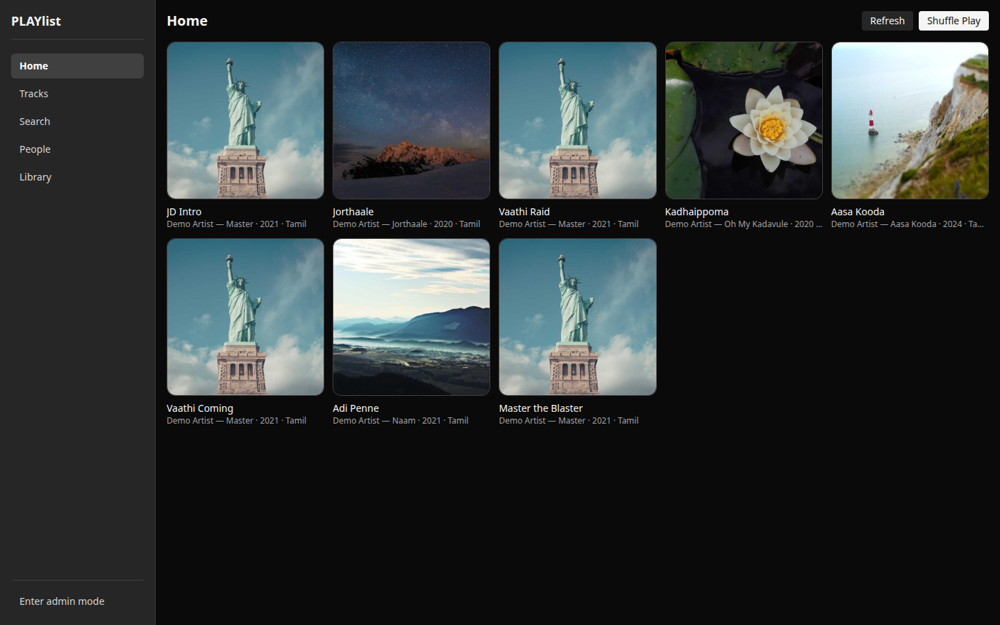
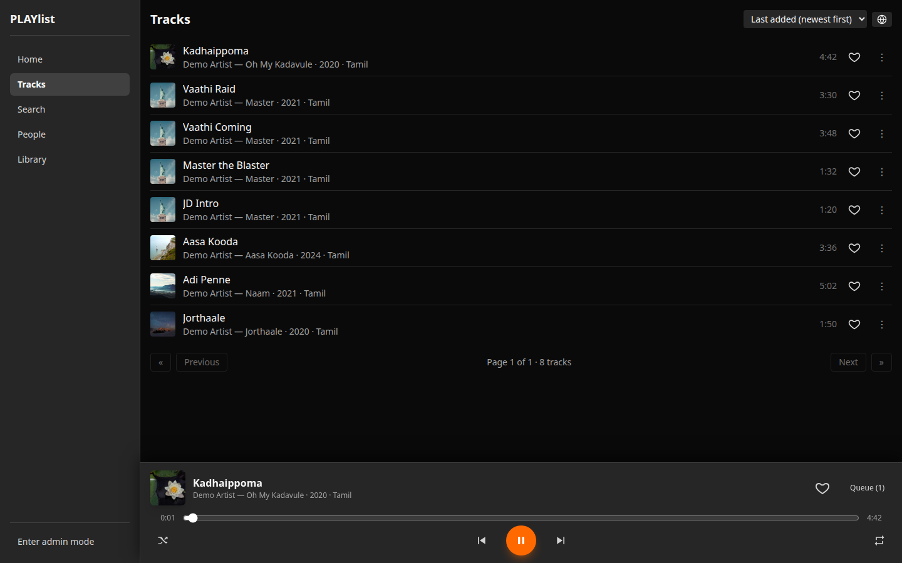
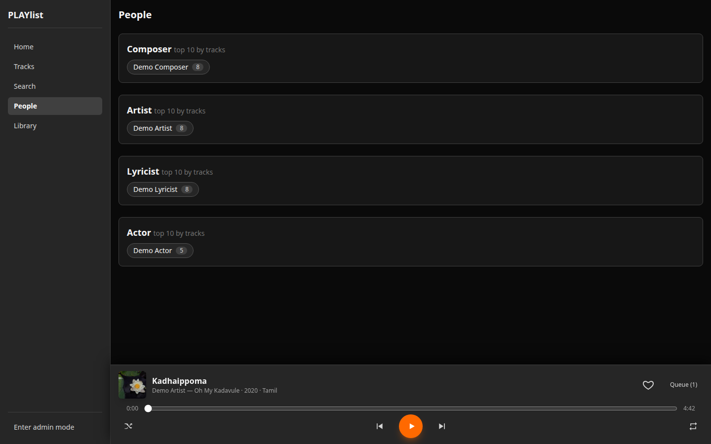
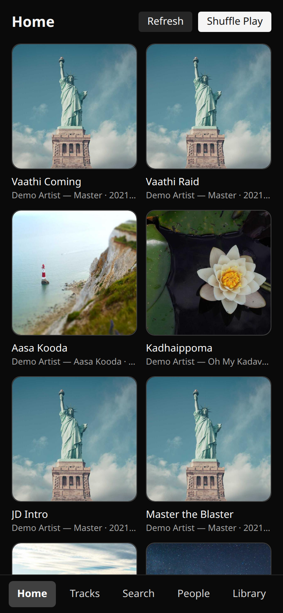
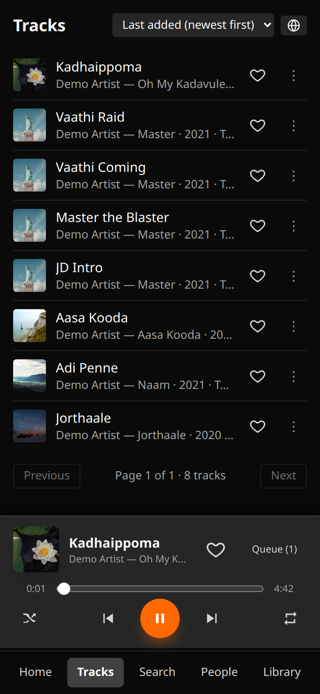
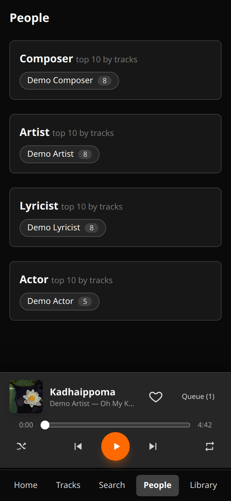

# PLAYlist

A local, single-user music library: manage tracks with metadata, browse by album and person, build playlists, and play uploaded audio (mp3, m4a, opus).

## Stack

- **Server:** NestJS, Prisma, PostgreSQL 17 (`server/`)
- **Web:** React, Vite, Tailwind, TanStack Query, Zustand (`web/`)
- **Runtime:** Docker Compose (app on port 3000, Postgres on host port 5432)

## Run

```bash
docker compose up -d --build app
```

Open http://localhost:3000. Migrations run on server start.

Audio files are stored under `./audio` (mounted at `AUDIO_ROOT=/app/audio`). The container runs as UID 1000, so the host folder must be writable by that user.

Postgres is exposed on host port 5432.

## Development

```bash
cd web && npm run dev      # Vite dev server, proxies /api to localhost:3000
cd server && npm run test  # server tests
cd web && npm run build    # type-check and build
cd web && npm run lint
```

After changing web code, rebuild the image so the served UI is updated: `./start.sh --build`.

## Features

### Library

- Tracks have metadata (album, year, language, type, people and roles). Albums are unique by name and year.
- Tabs: **Home** (album cards with Shuffle Play), **Tracks** (full track list), **Search** (filter tracks), **People**, and **Library**.
- Browse by album, by person (grouped as Composer / Artist / Lyricist / Actor), or by playlist.
- **Library** holds Favourites and your playlists as tiles. Playlists can be renamed, deleted, and reordered.
- Track metadata comes from the form. The iTunes lookup shows up to 3 matches; **Use these values** copies one into the form.
- People can be renamed on the Manage page. They can be deleted on the Delete page or with the (−) button on the People list. A person cannot be deleted while any track (archived included) uses them, and the button is disabled in that case.

### Album art

- Art is the embedded picture inside the audio file. It is read when a file is uploaded.
- Each track stores its own art. A track without art shows the first art found in its album (lowest track ID).
- Uploading a new audio file replaces that track's art. A file with no embedded picture clears it. Metadata-only edits keep the art.
- To change art manually: embed the new picture in the audio file with a tag editor (e.g. Mp3tag, foobar2000, or `eyeD3`/`ffmpeg`), then upload that file from the track's edit page.

### Player

- The player bar appears at the bottom once something is queued.
- **Play Now / Play Next / Add to Queue** on any track, or **Play** on albums, playlists, and each person section (Composer / Artist / Lyricist / Actor). Person and album Play buttons replace the queue. Person Play skips tracks without audio.
- Controls: shuffle (left), previous / play / next (centre), repeat (right).
- **Shuffle** randomly reorders the tracks after the current one. The current track and earlier ones stay in place. It is a one-off action, not a mode.
- **Repeat** (on/off, remembered in the browser) restarts the queue from the first track when it finishes. With a one-track queue, that track restarts.
- If a track has no audio file, playback skips to the next queued track. The "Audio missing" dialog appears only when the missing track is the last in the queue.
- The queue, its position, and the repeat setting are stored in the browser's localStorage, so each device keeps its own.

## Screenshots

Screenshots use mock data (sample albums, people, and generated audio), not a real library. Cover art is free stock photos from [picsum.photos](https://picsum.photos) (Unsplash photos).

### Desktop

| Home | Tracks | People |
| --- | --- | --- |
|  |  |  |

### Mobile

| Home | Tracks | People |
| --- | --- | --- |
|  |  |  |

## Admin mode

The app has two modes. **Normal** (the default) lets anyone browse, play, toggle favourites, and create playlists. **Admin** also enables adding, editing and deleting tracks, and adding, renaming and deleting people. The server enforces this with the `x-admin-token` header on those write routes; hiding buttons alone is not protection.

- **Enter / leave:** use the *Admin mode* control in the sidebar (or above the content on mobile). Admin mode lasts for the browser tab only (`sessionStorage`), and no restart is needed.
- **Set the token:** add `ADMIN_TOKEN=` (at least 12 characters) to `server/.env` before the first start. It is stored as a salted scrypt hash in the `settings` table. After that, `ADMIN_TOKEN` is ignored, so use the *Change token* control to rotate it.
- **Not configured:** if no token is stored, admin mode cannot be entered and the write routes return `403`.
- **Limits:** the token check is not rate-limited. Use a long token, and run the app only on a trusted network.

### Recovery: lost or forgotten admin token

Run these from the project root:

1. Remove the stored hash:
   ```bash
   docker compose exec db psql -U playlist -d playlist -c "DELETE FROM settings WHERE key = 'admin_token_hash';"
   ```
2. Set a new token in `server/.env`: `ADMIN_TOKEN=<at least 12 characters>`.
3. Restart the app so it seeds the new hash: `docker compose up -d app`.
4. Open the app, use *Enter admin mode*, and enter the new token.

Editing `ADMIN_TOKEN` alone does nothing while a hash is stored. Step 1 is required.

## Offline Android dashboard

A read-only Android app to browse and search the library, with stats and album art. It works from a snapshot file, so the phone doesn't need the server.

1. **Export the library** (needs the database running, and `DATABASE_URL` in `server/.env`):
   ```bash
   cd scripts/export-sqlite
   npm install
   npm run export
   ```
   This writes `scripts/export-sqlite/out/library.db`, a SQLite file with 300px album art thumbnails.
2. **Copy it to the phone**, for example with `adb push scripts/export-sqlite/out/library.db /sdcard/Download/`.
3. **Import it** in the app with the file picker. Re-run the export and copy again whenever the library changes. The APK doesn't need rebuilding for data changes.

**Build the app** (JDK 17, Android SDK platform 34 and build-tools 34.0.0, Gradle 8.10.2):
```bash
cd android
gradle assembleDebug
```
The APK is written to `android/app/build/outputs/apk/debug/app-debug.apk`. Install it with `adb install -r`, or copy it to the phone. Use `./gradlew assembleDebug` if your network can reach the Gradle download server; otherwise use the installed `gradle assembleDebug`. Set `sdk.dir` in `android/local.properties` to your SDK path.

## Notes

- Requirements and decisions: see [REQUIREMENTS.md](./REQUIREMENTS.md).
